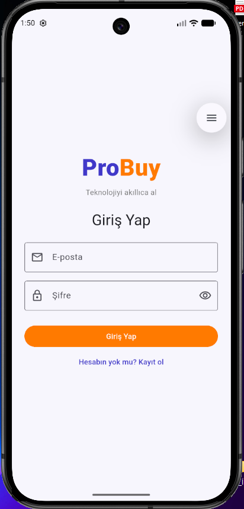

# ProBuy 🛒

**Pro**Buy; Flutter ile geliştirilmiş, Firebase destekli bir mobil alışveriş uygulamasıdır. Alıcılar ürünleri inceleyip sepete ekler, sipariş verir, puanlar; işletmeler kendi paneliyle ürün ve siparişleri yönetir.

Bu proje, "Mobil Uygulama Geliştirme (Android / iOS)" dersi proje yönergesi kapsamında hazırlanmıştır. Başlangıçta "Mini Katalog" olarak tasarlanmış, yönergenin asgari şartlarının (ürün listesi, detay ekranı, `GridView`, sepet) ötesine geçerek tam bir alışveriş akışına dönüştürülmüştür.

---

## 📋 İçindekiler
- [Özellikler](#-özellikler)
- [Ekran Görüntüleri](#-ekran-görüntüleri)
- [Teknolojiler ve Paketler](#-teknolojiler-ve-paketler)
- [Kurulum ve Çalıştırma](#-kurulum-ve-çalıştırma)
- [Firebase Kurulumu](#-firebase-kurulumu)
- [Proje Yapısı](#-proje-yapısı)
- [Veri Modeli (Firestore)](#-veri-modeli-firestore)
- [Bilinen Sınırlamalar](#-bilinen-sınırlamalar)
- [Yönerge Karşılığı ve Teslim Listesi](#-yönerge-karşılığı-ve-teslim-listesi)

---

## ✨ Özellikler

### Alıcı
- **Splash ekranı:** ProBuy logosu, "Buy" kısmı yukarıdan düşme animasyonuyla gelir.
- **Kayıt / giriş / şifre sıfırlama** (Firebase Authentication).
- **Ürün listesi:** `GridView` ile iki sütun; stokta olmayan ürünler listenin en altında "Tükendi" olarak gösterilir.
- **Arama ve filtreleme:** ürün, kategori veya satıcıya göre arama; kategori, sıralama (fiyat / puan), yalnızca indirimli, yalnızca stokta olanlar.
- **Ürün detayı** (`RouteSettings.arguments` ile): açıklama, öne çıkan özellikler, teknik özellikler tablosu, canlı stok bilgisi, adet seçici, sepete ekle, yorumlar.
- **Satıcı bilgisi:** her ürünün hangi şirket tarafından satıldığı listede ve detayda görünür.
- **İndirim:** işletme fiyatı düşürürse eski fiyat üstü çizili, yeni fiyat ve `%X İNDİRİM` rozetiyle gösterilir. Fiyat artarsa indirim kalkar, ek işlem olmaz.
- **Favoriler:** kalp butonuyla ekle/çıkar, ayrı sekmede listele.
- **Sepet:** stok limitine göre adet artırma, satır ve genel toplam, ürün detayına geçiş. Başka kullanıcı ürünü bitirirse sepet otomatik düzeltilir ve kullanıcı bilgilendirilir.
- **Ödeme (simülasyon):** adres yoksa uyarır ve profile yönlendirir; sipariş oluşturulunca stok düşer.
- **Siparişlerim:** tek listede, tarihe göre sıralanabilir. Ürün detayına gidebilir, üçüncü parti kargo takibini taklit eden ilerleme çubuğu, adres, tutar, takip no gösterilir. Kargoya verilmeden iptal edilebilir (stok geri eklenir). İşletme iptal ederse neden gösterilir.
- **Puan ve yorum:** teslim edilen ürünlere 1–5 yıldız ve yorum. Ortalama puan ürün adının yanında renkli rozetle görünür (4.5–5 koyu yeşil → kötüleştikçe kırmızı).
- **Profil:** ad, telefon, adres güncelleme; şifre sıfırlama e-postası; çıkış. Kaydetme ve çıkışta onay sorulur.

### İşletme
- Kayıt sırasında "İşletme hesabı oluştur" seçeneği ve işletme kodu.
- **Ürün yönetimi:** ekleme (**fotoğraf zorunlu**, galeri/kamera), düzenleme (fiyat, stok, açıklama, özellikler), silme (onaylı). Ortalama puan ve değerlendirme sayısı listede görünür.
- **Sipariş takibi:** hangi üründen kaç adet sipariş edildiği, sipariş kartları.
- **KVKK uyumlu görünüm:** alıcı adı `A*** Y***` şeklinde, adres yalnızca ilçe/il düzeyinde gösterilir.
- **Sipariş iptali:** sipariş alındı / hazırlanıyor aşamasında, zorunlu bir neden yazılarak iptal edilebilir; stok geri eklenir ve alıcı nedeni görür.

---

## 📸 Ekran Görüntüleri

> Ekran görüntülerini `docs/screenshots/` klasörüne ekleyip aşağıdaki yolları güncelleyin.

| Splash | Giriş | Ana Sayfa |
|:--:|:--:|:--:|
|  |  |  |

| Arama / Filtre | Ürün Detayı | Sepet |
|:--:|:--:|:--:|
|  |  |  |

| Siparişlerim | Puan & Yorum | Profil |
|:--:|:--:|:--:|
|  |  |  |

| İşletme – Ürünler | İşletme – Ürün Formu | İşletme – Siparişler |
|:--:|:--:|:--:|
|  |  |  |

---

## 🧰 Teknolojiler ve Paketler

| | |
|---|---|
| **Flutter** | 3.47.8 (stable) |
| **Dart** | ^3.13.7 |
| **State yönetimi** | `StatefulWidget` + `StreamBuilder` (ek paket yok) |

Yönergedeki "ekstra paket kullanılmaz" kuralına karşın aşağıdaki paketler **bilinçli olarak** eklenmiştir:

| Paket | Neden |
|---|---|
| `firebase_core` | Firebase başlatma |
| `firebase_auth` | Kullanıcı kaydı / girişi |
| `cloud_firestore` | Ürün, sepet, favori, sipariş, yorum verisi |
| `image_picker` | İşletmenin ürün fotoğrafı seçmesi |

---

## 🚀 Kurulum ve Çalıştırma

**Gereksinimler:** Flutter 3.47.8 (veya uyumlu bir sürüm), Android Studio / VS Code, Android emülatörü ya da cihaz, bir Firebase projesi.

```bash
git clone https://github.com/Berdowski22/YollaGelsin.git
cd YollaGelsin
flutter pub get
# Firebase kurulumunu tamamladıktan sonra:
flutter run
```

> ⚠️ `google-services.json` dosyası depoda **bulunmaz**. Çalıştırmadan önce aşağıdaki Firebase adımlarını uygulayın.

> 💡 Proje yolunda Türkçe karakter varsa `flutter analyze` hata verebilir; bu durumda `dart analyze lib` kullanın.

---

## 🔥 Firebase Kurulumu

1. [Firebase Console](https://console.firebase.google.com)'da yeni bir proje oluşturun.
2. Android uygulaması ekleyin; paket adını `android/app/build.gradle*` içindeki `applicationId` ile aynı girin.
3. İndirilen `google-services.json` dosyasını `android/app/` klasörüne koyun.
4. **Authentication → Sign-in method → Email/Password** yöntemini etkinleştirin.
5. **Firestore Database** oluşturun. Geliştirme için test modu yeterlidir:
   ```
   rules_version = '2';
   service cloud.firestore {
     match /databases/{database}/documents {
       match /{document=**} { allow read, write: if request.auth != null; }
     }
   }
   ```
6. İlk açılışta `assets/data/product.json` içindeki örnek ürünler Firestore'a otomatik yüklenir.
7. **İşletme hesabı** için kayıt ekranında "İşletme hesabı oluştur" seçeneğini açıp kodu girin: `PROBUY2026` (demo amaçlı, `AuthService.businessCode`).

`.gitignore` içine eklenmesi önerilenler:
```
android/app/google-services.json
ios/Runner/GoogleService-Info.plist
firebase.json
.firebaserc
lib/firebase_options.dart
```

---

## 🗂 Proje Yapısı

```
lib/
├── main.dart                  # Firebase başlatma, tema, açılış
├── models/                    # Product, CartItem, Order
├── services/                  # auth, product, cart, order, review (Firestore erişimi)
├── screen/                    # tüm ekranlar (alıcı + işletme)
├── widgets/                   # ProductCard, ProductGrid, RatingBadge, ReviewDialog, onay diyaloğu
├── theme/app_theme.dart       # Pro (indigo) / Buy (turuncu) renk teması, BrandName
└── utils/privacy.dart         # KVKK maskeleme (ad, adres)
assets/
├── data/product.json          # Örnek ürün verisi
└── images/                    # Ürün görselleri
```

---

## 🗃 Veri Modeli (Firestore)

```
products/{id}                    id, name, description, price, oldPrice?, category, image,
                                 rating, ratingCount, stock, features[], specs{},
                                 sellerName, sellerId
products/{id}/reviews/{uid}      userName (maskeli), rating, comment, createdAt
users/{uid}                      name, email, role (customer|business), phone, address
users/{uid}/cart/{productId}     ürün özeti + quantity
users/{uid}/favorites/{id}
users/{uid}/orders/{id}          items[], total, status, name, phone, address, carrier,
                                 trackingNo, createdAt, cancelledBy, cancelReason, reviewed{}
meta/seed                        örnek verinin tekrar yüklenmesini engelleyen işaretçi
```

---

## ⚠️ Bilinen Sınırlamalar

Bunlar bir ders projesi olarak bilinçli sadeleştirmelerdir:

- Ödeme ve kargo **simülasyondur**; sipariş durumu sipariş yaşına göre (1 / 3 / 10 dk) hesaplanır.
- KVKK maskeleme istemci tarafındadır; gerçek bir sistemde sunucu tarafında yapılmalıdır.
- İşletme kodu istemcide kontrol edilir; Firestore güvenlik kuralları test düzeyindedir.
- Tüm işletmeler aynı ürün havuzunu yönetebilir (ürün sahipliği kısıtı yok).
- İşletme fotoğrafları küçültülüp Firestore'da base64 olarak saklanır (Firebase Storage kullanılmaz).
- Dosya adları `camelCase`'dir (`file_names` lint bilgisi verir).

---

## ✅ Yönerge Karşılığı ve Teslim Listesi

| Yönerge şartı | Durum |
|---|---|
| Ürün listesi | ✔ Firestore'dan, `GridView` ile |
| Detay ekranı (Route Arguments) | ✔ `RouteSettings.arguments` |
| Basit sepet | ✔ Stok kontrollü, toplam tutarlı |
| Ekstra | ✔ Auth, favoriler, sipariş, yorum, işletme paneli, arama/filtre |

### GitHub teslimi
- [x] Depo public: **Evet** *(teslimden önce GitHub → Settings → Danger Zone → "Change visibility" ile kontrol edin)*
- [x] Depoda güncel ve çalışan kaynak kod var.
- [x] README proje adı, kısa açıklama, Flutter sürümü (3.47.8) ve çalıştırma adımlarını içeriyor.
- [ ] Ekran görüntüleri depoya eklendi → `docs/screenshots/` klasörüne yukarıdaki dosya adlarıyla koyun.

---

## 👤 Geliştirici

**Berdowski22** — Mobil Uygulama Geliştirme dersi proje ödevi.
